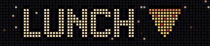
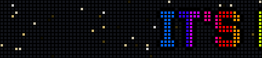
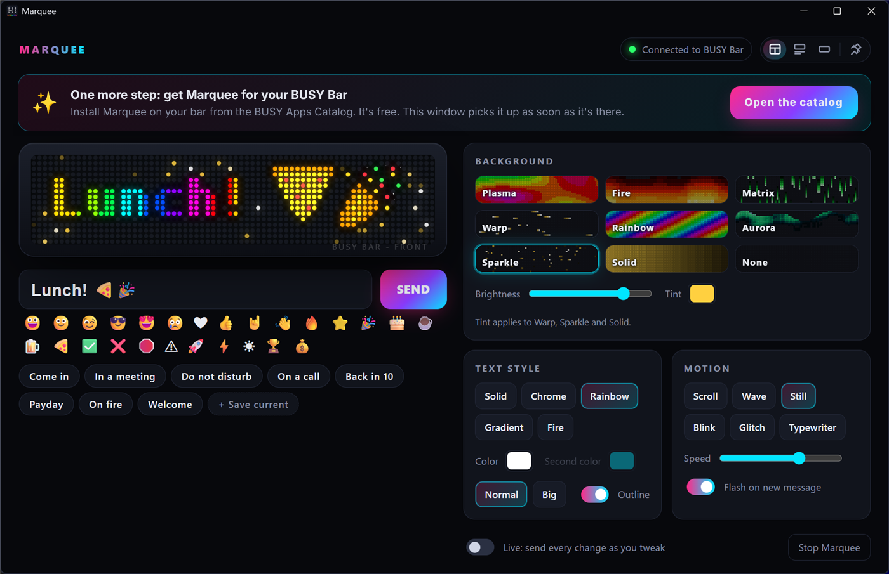

 

## Get started in 3 steps (Windows)

**1. Download `Marquee.exe` below.** It's a single file with nothing else to install.

**2. Plug in your BUSY Bar with its USB cable and open Marquee.exe.** Marquee finds the bar on its own.

> Windows may say it "protected your PC" the first time, because Marquee is new. Click **More info**, then **Run anyway**.

**3. Click "Install on my bar."** The first time, Marquee puts its app on your BUSY Bar for you. It takes about ten seconds.

Then type a message, tap an emoji, pick a look, and click **Send**. Once it's on the bar, it keeps running even with your computer off.

**Already have Marquee on your bar?** Just open the new Marquee.exe. If your bar has an older version, it offers a one-click update and keeps your current message.

**Mac or Linux?** Download `marquee-widget-mac-linux.zip` below. On a Mac, double-click `widget/Marquee.command` inside it (needs [Node.js](https://nodejs.org)), and it offers the same one-click install. See the [Mac or Linux steps](https://github.com/RocketGod-git/busy-bar-marquee#mac-or-linux).
