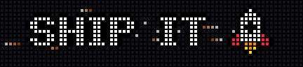
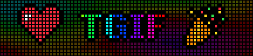
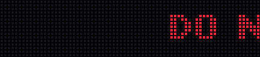
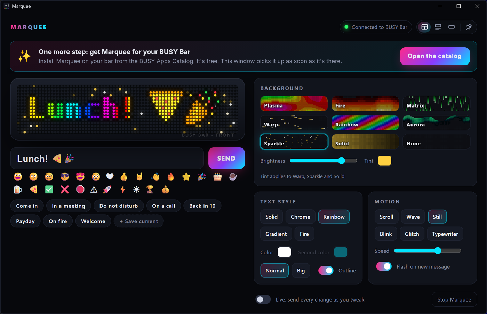
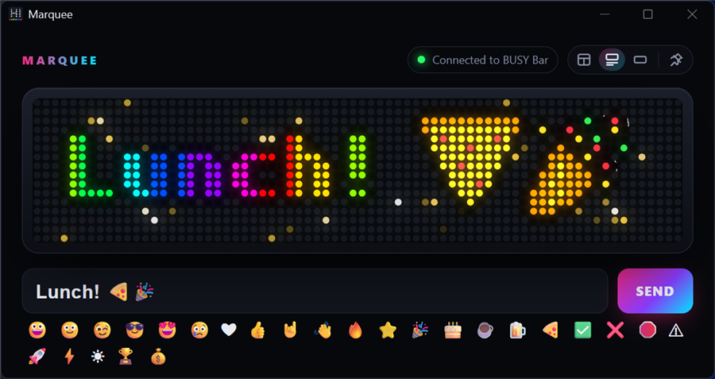
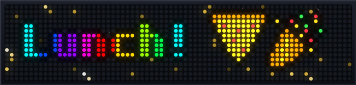
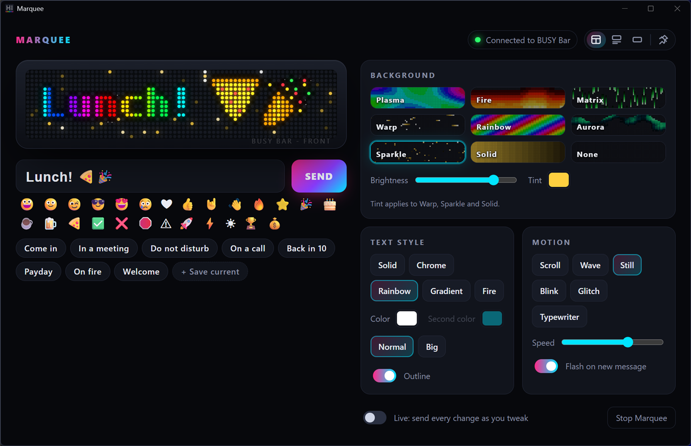

# Marquee for BUSY Bar

**Turn your [BUSY Bar](https://busy.bar) into an animated, full-color message board.** Type a message on your computer, pick a look, and it lights up the bar, emoji included.

<p align="center">
  <a href="https://github.com/RocketGod-git/busy-bar-marquee/releases/latest/download/Marquee.exe"></a>
  <a href="../../releases/latest"></a>
</p>

<p align="center">
  
  
  
  
  
  
  
  
</p>

## Get started in 3 steps

You need a BUSY Bar, its USB cable, and a Windows PC. (Mac or Linux? See [below](#mac-or-linux).)

**1. Download [Marquee.exe](https://github.com/RocketGod-git/busy-bar-marquee/releases/latest/download/Marquee.exe).** It's a single file with nothing else to install.

**2. Plug in your BUSY Bar and open Marquee.exe.** Marquee finds the bar on its own.

> Windows may say it "protected your PC" the first time, because Marquee is new. Click **More info**, then **Run anyway**.

**3. Click "Install on my bar."** The first time, Marquee puts its app on your BUSY Bar for you. It takes about ten seconds.

<p align="center"></p>

That's it. Type a message, tap an emoji, pick a look, and click **Send**. Once it's on the bar, it keeps running even with your computer off.

**Tip:** right-click Marquee's icon on your taskbar and choose **Pin to taskbar** to keep it one click away. Marquee offers to show you how the first time.

## Pick a view

Use the buttons at the top right to switch views. Each view remembers its own window size and spot on your screen, and the window always scales to fit, so there's no scrolling.

<table>
  <tr>
    <td align="center" width="50%"><br><b>Screen and message</b><br>Just the preview, the message box, and emoji.</td>
    <td align="center" width="50%"><br><b>Screen only</b><br>Just the glowing sign, no window frame. Drag it anywhere, pull an edge to resize it, and hover for the controls. Double-click it to go back.</td>
  </tr>
</table>

The pin button next to the views keeps Marquee on top of your other windows.

<p align="center"></p>

## What it can do

- **Backgrounds:** Plasma, Fire, Matrix rain, Warp speed, Rainbow, Aurora, Sparkle, Solid, None.
- **Text styles:** Solid, Chrome glint, Rainbow, Gradient, Fire.
- **Motion:** Scroll, Wave, Still, Blink, Glitch, Typewriter.
- **Emoji:** 26 full-color pixel-art emoji, including faces, hearts, thumbs up, fire, stars, coffee, pizza, and party. They show on the bar's back screen too.
- **Presets:** one click for "Come in," "In a meeting," "Do not disturb," and more, plus your own saved looks.
- **Live preview:** the app runs the exact same renderer as the bar, so what you see is what you get.
- **Options:** two text sizes, a black outline that keeps text readable over busy backgrounds, and a white flash plus LED blink when a new message arrives.

**At the bar:** scroll wheel = cycle backgrounds · OK = cycle motion · Start = cycle text style · Back = quit. You can also start **Marquee** from the bar itself (mode selector → **Apps**).

## Mac or Linux

1. Install [Node.js 24](https://nodejs.org) if you don't have it.
2. Download [marquee-widget-mac-linux.zip](https://github.com/RocketGod-git/busy-bar-marquee/releases/latest/download/marquee-widget-mac-linux.zip) and unzip it.
3. Plug in your BUSY Bar with its USB cable.
4. **Mac:** double-click `widget/Marquee.command`. If macOS says it can't check the file, right-click it, choose **Open**, then **Open** again (on newer macOS, go to **System Settings → Privacy & Security** and click **Open Anyway**).
   **Linux:** run `node widget/server.mjs --open`.
5. Click **Install on my bar**, just like on Windows. Marquee opens in a Chrome or Edge app window.

## Over Wi-Fi

Marquee talks to the bar over USB by default. To use Wi-Fi instead, create a `config.json` with `addr` set to the bar's IP address, plus `password` if **Password protection** is on in the bar's web interface (see `widget/config.example.json`). On Windows, put it in `%APPDATA%\Marquee`. On Mac or Linux, put it in `widget/`, or use the `--addr` / `--password` flags. The `BUSY_ADDR` / `BUSY_PASSWORD` environment variables work everywhere.

## How it renders

The bar's text and image elements can't do per-letter color or motion, so Marquee draws every frame itself.

- **The frame:** a 72×16 software framebuffer is sent as one XPM bitmap about 10–12 times a second.
- **The font:** the pixel font in `marquee/src/font.ts` was read off the bar's own screen with `tools/grabfont.mjs`, so text looks native.
- **Speed:** the bar's JavaScript engine is slow, so the renderer is built around that:
  - Plasma, rainbow, and aurora are precomputed fields that slide with native typed-array copies and animate by rotating the palette.
  - Matrix, warp, and sparkle draw only their lit pixels.
  - Fire is simulated at half resolution.
  - Text and its outline are precomputed pixel lists, and only on-screen columns are drawn.
  - The framebuffer stores XPM character codes, so each output row is a single `String.fromCharCode` call.
  - All per-pixel math is integer-only.

Marquee is busier than most apps, so quit it (Back) when you don't need it.

## Build from source

You need Node.js 24 (Node 26 isn't supported by the BUSY build tools yet).

```sh
npm run setup        # install dependencies
npm run build        # build marquee/dist/app.rocketgod.marquee.tgz
```

To install on a bar connected over USB: `cd marquee && npm run app:install && npm run app:run`.

To build `Marquee.exe` (needs the .NET 10 SDK), run `npm run build` first so the bar app gets packed inside it, then `powershell -ExecutionPolicy Bypass -File widget\app\install.ps1`. That installs it to `%LOCALAPPDATA%\Programs\Marquee` and adds Start menu and desktop shortcuts.

Developer tools in `tools/`:

| Script | Purpose |
| --- | --- |
| `snap.mjs` | Saves both screens of a connected bar as PNGs |
| `sheet.mjs` | Stacks screenshots into one image |
| `grabfont.mjs` | Rebuilds `marquee/src/font.ts` from the bar's fonts |
| `demo.mts` | Renders the animated sign images above |
| `icons.mjs`, `ico.mjs` | Generate the app and widget icons |

`marquee/preview.mts` draws looks straight onto a connected bar from your computer. All of these honor `BUSY_ADDR`.

Pushing a tag like `v1.0.0` builds the bar app, packs it into `Marquee.exe`, and publishes a GitHub release with `Marquee.exe`, the `.tgz` file, and the Mac/Linux widget zip. The release page opens with the install steps from `.github/release-notes.md`, followed by the tag's message as "What's new".

## Credits

BUSY Bar, `@busy-app/busy-lib`, and `@busy-app/cli` are by Flipper FZCO. The pixel font is derived from the BUSY Bar's built-in fonts.

Released under the [MIT License](LICENSE).
