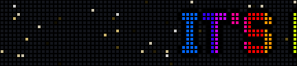
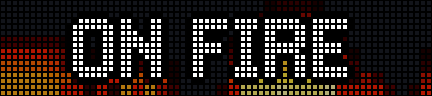
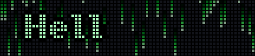
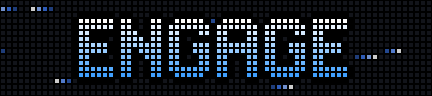
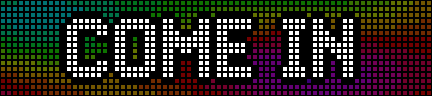
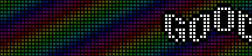
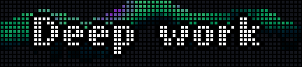
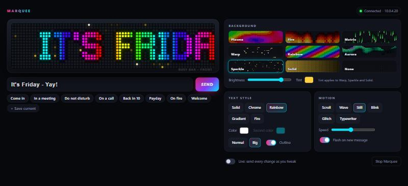

# Marquee for BUSY Bar

An animated message board for the [BUSY Bar](https://busy.bar), with a desktop widget to drive it.

<p align="center">
  
  
  
  
  
  
  
  
</p>

- **Backgrounds:** Plasma, Fire, Matrix rain, Warp speed, Rainbow, Aurora, Sparkle, Solid, None.
- **Text styles:** Solid, Chrome glint, Rainbow, Gradient, Fire.
- **Motion:** Scroll, Wave, Still, Blink, Glitch, Typewriter.
- **Options:** two text sizes, a black outline that keeps text readable over busy backgrounds, and a white flash plus LED blink when a new message arrives.

Everything renders on the bar itself, so once a message is set it keeps running with your computer off.

## Install

1. Download `app.rocketgod.marquee-<version>.tgz` from the [latest release](../../releases/latest).
2. Connect the BUSY Bar over USB and open <http://10.0.4.20>.
3. Go to **Apps** → **+ Add app**. Pick the `.tgz` file, click **Upload**, then **Install app**.
4. Start **Marquee** from the bar (mode selector → **Apps**) or from the web interface.

**At the bar:** scroll wheel = cycle backgrounds · OK = cycle motion · Start = cycle text style · Back = quit.

Every option is also in the app's settings in the bar's web interface. The desktop widget is faster, though.

## Desktop widget

<p align="center"></p>

The widget is a small control panel with:

- a live LED preview that runs the same renderer as the bar
- animated background tiles
- one-click presets, plus your own saved presets
- color pickers and sliders

**Send** (or Enter) pushes the look to the bar and brings Marquee to the front. **Live** streams every tweak as you make it. The layout adapts to any window size.

You need [Node.js 24](https://nodejs.org) and the Marquee app installed on the bar. Get the widget by downloading `marquee-widget.zip` from the release, or by cloning the repository.

- **Windows:** double-click `widget\Marquee.vbs`. To get a desktop shortcut, run `powershell -ExecutionPolicy Bypass -File widget\install-shortcut.ps1`.
- **macOS or Linux:** run `node widget/server.mjs --open`.

It opens as an app window in Edge or Chrome, and the background server exits a minute after you close the window.

**Over Wi-Fi:** the widget uses USB (10.0.4.20) by default. To use Wi-Fi instead, copy `widget/config.example.json` to `widget/config.json` and set `addr` to the bar's IP. Set `password` if **Password protection** is on in the bar's web interface. You can also use the `--addr` / `--password` flags or the `BUSY_ADDR` / `BUSY_PASSWORD` environment variables.

## How it renders

The bar's text and image elements can't do per-letter color or motion, so Marquee draws every frame itself.

- **The frame:** a 72×16 software framebuffer is sent as one XPM bitmap about 10–12 times a second.
- **The font:** the pixel font in `marquee/src/font.ts` was read off the bar's own screen with `tools/grabfont.mjs`, so text looks native.
- **Speed:** the bar's JavaScript engine is slow, so the renderer is built around that:
  - Plasma, rainbow, and aurora are precomputed fields that slide with native typed-array copies and animate by rotating the palette.
  - Matrix, warp, and sparkle draw only their lit pixels.
  - Fire is simulated at half resolution.
  - Text and its outline are precomputed pixel lists, and only on-screen columns are drawn.
  - The framebuffer stores XPM character codes, so each output row is a single `String.fromCharCode` call.
  - All per-pixel math is integer-only.

Marquee is busier than most apps, so quit it (Back) when you don't need it.

## Build from source

You need Node.js 24 (Node 26 isn't supported by the BUSY build tools yet).

```sh
npm run setup        # install dependencies
npm run build        # build marquee/dist/app.rocketgod.marquee.tgz
```

To install on a bar connected over USB: `cd marquee && npm run app:install && npm run app:run`.

Developer tools in `tools/`:

| Script | Purpose |
| --- | --- |
| `snap.mjs` | Saves both screens of a connected bar as PNGs |
| `sheet.mjs` | Stacks screenshots into one image |
| `grabfont.mjs` | Rebuilds `marquee/src/font.ts` from the bar's fonts |
| `demo.mts` | Renders the animated images above |
| `icons.mjs`, `ico.mjs` | Generate the app and widget icons |

`marquee/preview.mts` draws looks straight onto a connected bar from your computer. All of these honor `BUSY_ADDR`.

Pushing a tag like `v1.0.0` builds the app and publishes a GitHub release with the `.tgz` file and the widget zip.

## Credits

BUSY Bar, `@busy-app/busy-lib`, and `@busy-app/cli` are by Flipper FZCO. The pixel font is derived from the BUSY Bar's built-in fonts.

Released under the [MIT License](LICENSE).
